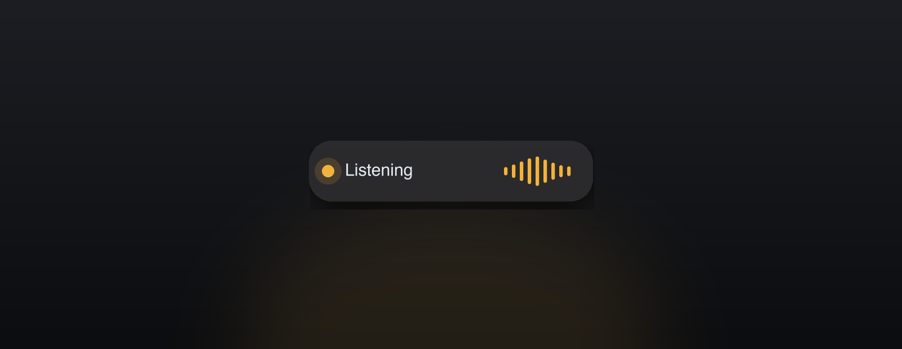
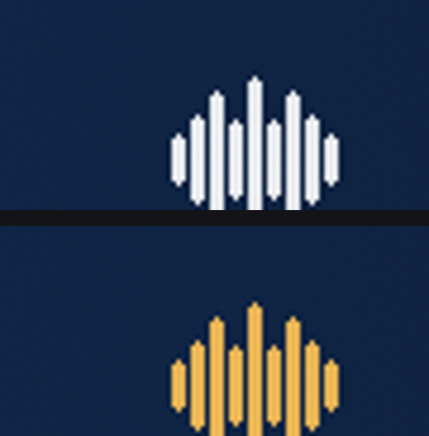
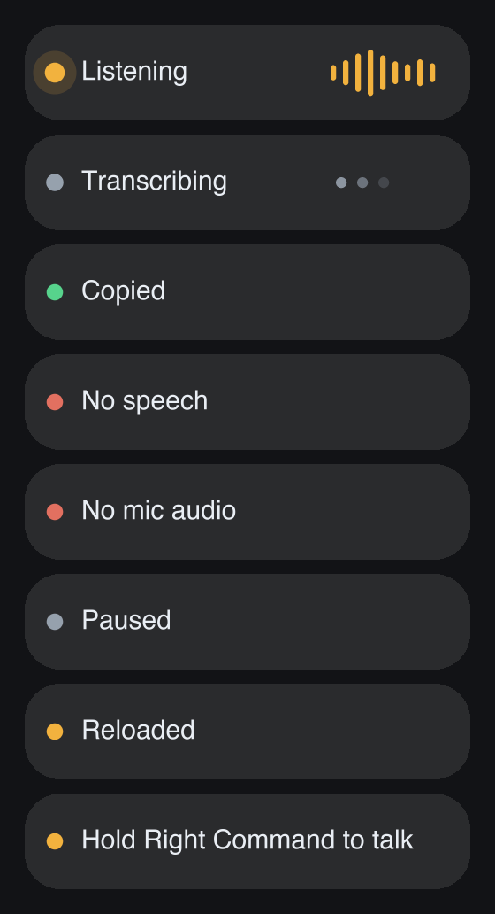
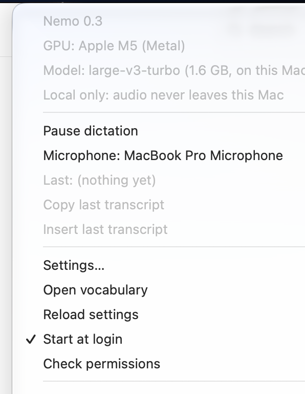
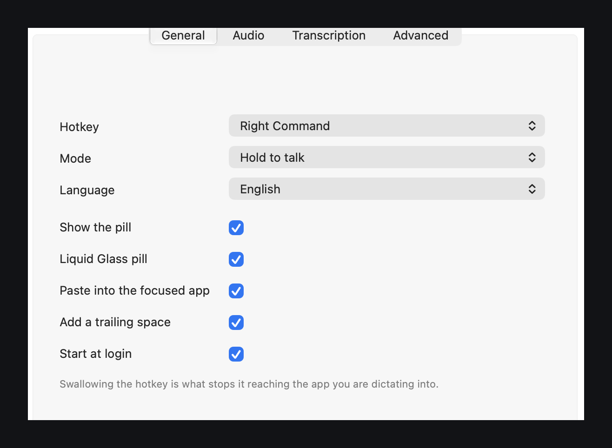

# Nemo for Mac

[](https://github.com/flyingsotong/nemo-mac/actions/workflows/macos-tests.yml)

Hold **Right Command**, speak, let go. The text appears where your cursor is, in
about a third of a second, entirely on this machine. No account, no cloud, no
telemetry, no history on disk.



Whisper `large-v3-turbo` runs on Metal through a resident `whisper-server`, so the
model is never loaded on the critical path. Audio goes to `127.0.0.1:8129` and
nowhere else.

```sh
brew install whisper.cpp        # the Metal engine, not bundled
git clone https://github.com/flyingsotong/nemo-mac && cd nemo-mac
./build.sh                      # builds and signs dist/Nemo.app
open dist/Nemo.app
```

The 1.6 GB model is fetched and SHA-256 verified on first run. macOS 26 or later
for the Liquid Glass pill; the painted pill is used below that.

## Use

Point at any text field, hold **Right Command**, talk, release. Escape cancels
while you are still holding. A press shorter than 0.3 s is treated as a tap and
ignored.

The pill appears on whichever screen holds the pointer, and the menu bar icon turns
**orange** while the microphone is open:



| Pill | Meaning |
|---|---|
| **Listening** | the microphone is open |
| **Transcribing** | the engine has the audio |
| **Copied** | on the clipboard and pasted |
| **No speech** | there was audio, but it was too quiet to be speech |
| **No mic audio** | the microphone returned digital silence; the device is reopened before your next press |
| **Paused** | dictation is off, and the key reaches the app normally |



The menu carries the engine and model the running process reports, a microphone
picker, the last transcript, settings and vocabulary, and start-at-login:



## How fast

Measured on a 14-inch MacBook Pro with an M5, not carried over from the Windows
build:

| | |
|---|---|
| key release → text on the clipboard | **301 ms** for a 6 s take |
| engine round trip, 640-frame window | ~290 ms |
| clipboard + Command-V | 4 ms |
| cold start to usable | 1.10 s |
| pill frame at 2x | 1.91 ms |
| idle, hidden | 0.2% of one core (app), 0.4% (engine) |

`small.en` transcribes the same take in 182 ms, at the cost of coined names. One
line in `config.json` switches.

## How it works

```
Right Command (swallowed) → Recorder: 16 kHz mono int16 → WAV in memory
    → POST 127.0.0.1:8129/inference  (multipart: file, response_format=text,
      temperature=0, language, prompt)
    → clean() → history → clipboard + Command-V → pill
```

Three decisions worth knowing:

- **The key is swallowed** by a `CGEventTap`, so it never reaches the focused app.
  A leaked Command would fire shortcuts — ⌘Q quits, ⌘W closes — which is why this
  is not optional.
- **The encoder window is a server setting.** Whisper always encodes a fixed
  window, so a 2 s take costs nearly what a 12 s one does; 640 frames (12.8 s) is
  the measured compromise, and a longer take restarts the engine wider. Because a
  wider window makes every later take slower, it returns to normal after 90 s
  without a dictation.
- **Silence is trimmed before sending.** Edge silence is not free: a 24 s take that
  was really 6 s of speech cost 1463 ms and opened the window to 1500 frames;
  trimmed, the same take costs 233 ms and stays at 640. It also transcribes better,
  because the decoder stops inventing words for the padding.
- **The pill is event-driven**, 30 Hz only while visible, with an activity
  assertion held so App Nap cannot throttle the tap.

## Settings

**Menu → Settings…** opens the window: hotkey, mode, language, appearance, the
microphone, the model, the encoder window, keep-warm, the silence gate and a
vocabulary editor.

 Changes apply as you make them; the engine restarts only for
the settings that need it.

Everything lives in `config.json` under `~/Library/Application Support/Nemo/`, so
it is still a text file if you prefer one — the window writes it, and the
**Advanced** tab opens it.

| Key | Default | Meaning |
|---|---|---|
| `HOTKEY` | `"right_command"` | `right_command` or `right_option` |
| `SUPPRESS_HOTKEY` | `true` | swallow the key; `false` lets it through |
| `DICTATION_MODE` | `"push"` | `"toggle"` for tap to start, tap to stop |
| `LANGUAGE` | `"en"` | `""` to auto-detect |
| `MODEL_FILE` | `ggml-large-v3-turbo.bin` | which file in `models/` |
| `MIC_DEVICE` | `null` | system default, a name substring, or an index |
| `PASTE` | `true` | `false` is clipboard only |
| `TRAILING_SPACE` | `true` | so two dictations do not run together |
| `GLASS` | `true` | Liquid Glass pill, or the painted one |
| `MIN_PEAK` | `0.025` | silence gate; learns from your takes |
| `AUDIO_CTX` | `640` | encoder window, in 20 ms frames |
| `KEEP_WARM_SEC` | `300` | silent inference while idle; stretched on battery |
| `OVERLAY` | `true` | `false` is silent mode |
| `THREADS` | `4` | performance cores |

`vocabulary.txt` holds one term per line, passed as Whisper's initial prompt. The
**first three carry the most weight** — this engine's prompt is positional, so a
term four tokens from the end has no effect at all.

## Known behaviour, not bugs

- **Vocabulary is a nudge plus a correction.** The prompt biases spelling, and
  then any capitalised word within two edits of a listed term is rewritten to that
  term — "Tellaria" becomes "Tolaria" — with every change logged. Ordinary words
  are left alone.
- **Password fields cannot be dictated into.** macOS blocks every event tap under
  secure input.
- **A doubled sentence is repaired, at a cost.** A short window occasionally makes
  the decoder repeat a sentence; the app detects the repeated words, retries at the
  full window, and stays there for the session.
- **The clipboard is overwritten**, and on macOS that reaches your other devices
  through Universal Clipboard.
- **`Copied` is only shown when the text actually reached the clipboard.** If the
  paste path fails you get an error, never a comfortable lie.

## Not in this version

Spoken formatting ("new line", "new paragraph"), a microphone picker, engine swaps
(Core ML, MLX), any cloud path, history on disk.

## Licence

MIT — see [LICENSE](LICENSE) and [THIRD-PARTY-NOTICES.md](THIRD-PARTY-NOTICES.md).
The engine is installed by Homebrew and is not redistributed here. There are no
LGPL dependencies: the hotkey is a `CGEventTap`, and the menu bar item an
`NSStatusItem`.

The Windows build, and this project's earlier history, live at
<https://github.com/flyingsotong/nemo>.
